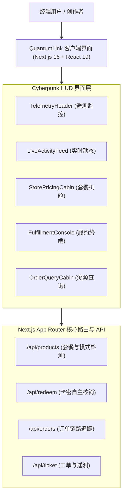

# QuantumLink · AI Subscription Autonomous Dispatcher

<div align="center">

```
  ____                 _                   _     _       _    
 / __ \               | |                 | |   (_)     | |   
| |  | |_   _  __ _ _ | |_ _   _ _ __ ___ | |    _ _ __ | | __
| |  | | | | |/ _` | '_ \ __| | | | '_ ` _ \| |   | | '_ \| |/ /
| |__| | |_| | (_| | | | | |_ |_| | | | | | | |___| | | | |   < 
 \___\_\\__,_|\__,_|_| |_|\__|\__,_|_| |_| |_|_____|_|_| |_|_|\_\
```

**Next.js 16 · React 19 · Full-stack Cyberpunk Autonomous Dispatcher & Fulfillment Console**

[](https://nextjs.org/)
[](https://react.dev/)
[](https://www.typescriptlang.org/)
[](https://tailwindcss.com/)
[](LICENSE)

[在线体验 (Live Demo)](#) · [功能特性 (Features)](#-核心特性) · [快速上手 (Quick Start)](#-快速开始) · [架构设计 (Architecture)](#-系统架构)

</div>

---

## ⚡ 概览 (Overview)

**QuantumLink** 是一套面向 AI 高并发订阅分发、自动化履约与凭证溯源的**赛博朋克极简风格终端系统**。采用前沿 **Next.js 16 + React 19 App Router** 全栈架构，专为自动化处理高频 AI 算力订阅、卡密核销、冲突预检及状态遥测而生。

- **视觉风格**：深空暗夜底色 (`#06090e`) + 赛博全息青 (`#00e5d8`) 微光粒子弥散，融合 HUD 网格与终端扫描线。
- **核心定位**：从“套餐选购 → 自主兑换履约 → 冲突检测 → 全链路凭证溯源”的工业级闭环。

---

## 🌟 核心特性 (Features)

### 1. 🛰️ 实时遥测监控 (Telemetry Header & Feed)
- 毫秒级节点引擎状态探测（`SANDBOX_SIMULATION` / `PRODUCTION_ACTIVE`）。
- 全息跑马灯实时广播队列动态、并发活跃任务数与全网吞吐。

### 2. 💎 订阅选购机舱 (Store Pricing Cabin)
- 模块化套餐卡片架构，多币种支持与优惠券动态折算。
- 内置防冲突预检卡片（Session Precheck Card），选购前阻断不兼容环境。

### 3. 🖥️ 自主兑换与任务履约控制台 (Fulfillment Console)
- 终端命令行交互体验，卡密激活、环境配置注入。
- 任务碰撞预警模态框（Collision Warning Modal），防止并发篡改与覆盖。

### 4. 🔍 凭证与订单全息溯源 (Order Query Cabin)
- 支持单号、卡密或邮箱的一键状态快照检索。
- 工单支持系统（Ticket Modal）无缝衔接。

---

## 🏗️ 系统架构 (Architecture)



---

## 🚀 快速开始 (Quick Start)

### 1. 克隆项目
```bash
git clone https://github.com/xiao44119-sketch/quantum-link.git
cd quantum-link
```

### 2. 安装依赖
```bash
npm install
# or
pnpm install
```

### 3. 配置环境变量
复制 `.env.example` 为 `.env.local`：
```bash
cp .env.example .env.local
```

### 4. 启动本地开发服务
```bash
npm run dev
```
打开浏览器访问 [http://localhost:3000](http://localhost:3000) 即可进入终端控制台。

---

## 🛠️ 技术选型 (Tech Stack)

| 分类 | 核心技术 | 说明 |
| :--- | :--- | :--- |
| **基础框架** | Next.js 16.3+ (App Router) | 最新前沿生产级 React 框架 |
| **视图层** | React 19.2+ | 极致并发与服务端组件支持 |
| **样式引擎** | Tailwind CSS v4 + PostCSS | 先锋暗色 HUD 滤镜与弥散光晕 |
| **组件交互** | Lucide React | 工业级极简线性图标库 |
| **语言规范** | TypeScript 5.0+ | 全链路严格类型安全 |

---

## 📄 开源许可 (License)

本项目基于 [MIT License](LICENSE) 开源。
欢迎 Star ⭐️ 与 PR 交流！
